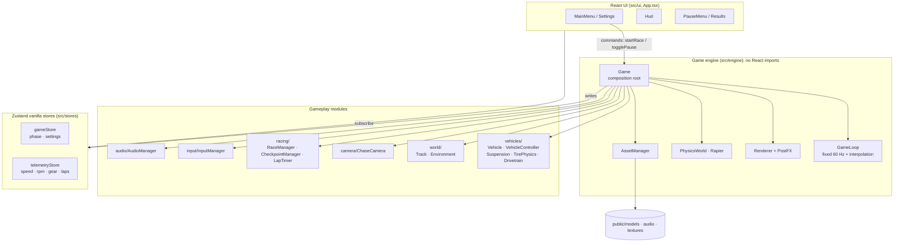
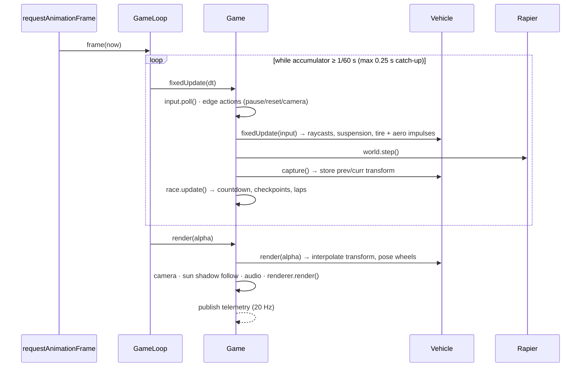

# Architecture

A browser racing game in the spirit of Need for Speed: a realistic-looking
McLaren on a beautiful circuit with arcade driving physics. It runs at a stable
60 FPS in a browser.

## Stack

| System | Technology | Responsibility |
| --- | --- | --- |
| Language | TypeScript (strict) | Type-safe game code |
| Build | Vite | Dev server, production builds |
| 3D engine | **vanilla Three.js** | Rendering, cameras, lights, shaders |
| UI | React 19 | Main menu, garage, HUD, settings, *not* game objects |
| Physics | Rapier 3D (`rapier3d-compat`, WASM) | Rigid bodies, collisions, raycasts |
| Vehicle | Custom TypeScript | Raycast suspension, tires, drivetrain, steering |
| State | Zustand (vanilla stores) | Phase, settings, HUD telemetry |
| Post FX | `postprocessing` (WebGL), TSL nodes (WebGPU trial) | Bloom, SMAA, ACES tone mapping |
| Audio | Web Audio (+ Howler for SFX/mixer) | Engine, tire squeal, effects |
| Input | Custom `InputManager` | Keyboard, gamepad (touch later) |
| Assets | Blender → Blender MCP → GLB/glTF 2.0 | Cars and tracks |
| Tests | Vitest | Pure physics and race-rule modules |
| Later | Node + PostgreSQL, Colyseus | Accounts/leaderboards, authoritative multiplayer |

**Key decision:** Three.js is used directly, not through React Three Fiber. React
only renders the 2D overlay. This gives the engine full control over the game loop,
physics sync, camera and per-frame allocation, which matter most for a
racing game.

## Layers



### Rules that keep it maintainable

1. **The engine never imports React.** React calls a small command API on `Game`
   (`startRace`, `togglePause`, `quitToMenu`, `resetCar`) and only *reads* the
   stores. The engine could run headless or under a different UI.
2. **Stores are the only bridge.** `gameStore` holds low-frequency state (phase,
   settings). `telemetryStore` holds HUD values, published at **20 Hz** rather than
   per frame, so React never re-renders at physics rate.
3. **Physics math is pure.** `TirePhysics`, `Suspension`, `Drivetrain`,
   `LapTimer` and `CheckpointManager` take numbers and return numbers. They have no
   Three.js scene or Rapier dependency, so they're unit tested and can later
   run on an authoritative multiplayer server.
4. **No per-tick allocation in hot paths.** `VehicleController` reuses module-level
   scratch vectors.
5. **Custom shaders have a node twin.** The WebGPU renderer (a beta setting, see
   [WebGPU](WEBGPU.md)) runs no `ShaderMaterial` or `onBeforeCompile`. Each one
   has a TSL version in `engine/nodes`, chosen by `backend.nodes`.
6. **Assets are data-driven.** A car is a GLB plus a `vehicle-config.json`. Adding
   a car needs no code beyond a registry row (see [Asset pipeline](ASSET_PIPELINE.md)).

## Frame lifecycle



Physics always ticks at a fixed 60 Hz, so handling is identical on 60 Hz and
144 Hz displays. Rendering interpolates between the last two ticks for smooth
motion. Determinism also makes replays, ghosts and server reconciliation
possible later.

## Vehicle model (raycast wheels)

The car is **one Rapier rigid body** (a box collider with explicit mass, a low
center of mass and box inertia) plus **four suspension raycasts**. Per wheel, per
tick:

1. Cast a ray from the suspension mount along the chassis' −up axis, length
   `restLength + radius`, excluding the chassis itself.
2. **Suspension** (`Suspension.ts`): a spring-damper gives the normal load. Push the
   chassis up at the contact point.
3. **Tire frame**: rotate forward/right by the steer angle for steered wheels;
   split contact-patch velocity into `vLong` and `vLat`.
4. **Longitudinal force**: drive force from the `Drivetrain` (torque curve ×
   gear × final drive ÷ radius) on driven wheels, minus brakes and handbrake.
   Brakes are clamped so they stop the wheel rather than reverse it.
5. **Lateral force** (`TirePhysics.ts`): Pacejka-lite `sin(C·atan(B·slip))` at
   speed. Below 1.5 m/s it becomes a velocity-cancelling impulse so a parked car
   doesn't jitter. It is always capped at what cancels sideways motion this
   tick.
6. **Friction circle**: combined force ≤ `load × grip`. With `tractionControl`
   (arcade, default on), cornering grip has priority, which stops full-throttle
   power oversteer. The handbrake scales rear grip down for drifts.
7. Apply tire impulses slightly above the contact patch to reduce body roll.

Each wheel also looks up the **surface** under its contact patch
(`RaceTrack.surfaceAt` → `Surface.ts`). Grass and gravel traps scale grip down,
and loose surfaces add heavy rolling drag. The tire model reports `slide`, the
speed the contact patch actually skids at: past the peak slip angle, locked by
the handbrake, or spinning under power. ABS braking and grippy cornering read
zero. Skid marks and smoke key off `slide`, not the friction-circle usage.

Then **aero**: quadratic drag through the centre of mass, and speed² downforce
split over the axles by `downforceFrontShare`. The steering angle is smoothed and
shrinks with speed.

The **stability assist** trims yaw beyond what the steering asks for. When the
car is sideways and the driver countersteers, it backs off to `driftAssist`, so
a slide can be held on throttle and opposite lock. Past `maxDriftAngle` it comes
back in full to catch a spin.

The automatic gearbox shifts up at `shiftUpRpm` and down at `shiftDownRpm`.
Holding brake at a standstill (total speed < 1 m/s) engages reverse, and the
pedals swap while reversing.

All tuning lives in `VehicleConfig`. Defaults approximate a McLaren 720S:
1420 kg, RWD, 8200 rpm redline, 7-speed.

## Coordinate conventions

These match glTF, so Blender exports need no runtime fix-ups:

- **Meters, kilograms, seconds.**
- **+Y up, +Z forward, +X left** (the car's right is −X).
- The car origin sits at ground level under the chassis center. Wheel mount
  points are given in that local space.

## Directory map

```
src/
├── engine/      Game (composition root), GameLoop, Renderer, PhysicsWorld, AssetManager,
│                backend + nodes/ (lazy WebGPU chunk: node materials, GPU particles, TSL post)
├── vehicles/    VehicleConfig (data contract), Vehicle, VehicleController,
│                Suspension, TirePhysics, Drivetrain, CarModel (GLB rigging), carRegistry
├── world/       RaceTrack (interface), Track (procedural), StreamedTrack (chunked GLB streaming),
│                streaming/ChunkPlanner (pure LOD planning), Environment (sky, sun, fog), tracks
├── camera/      ChaseCamera (chase + cockpit, speed FOV)
├── racing/      RaceManager, CheckpointManager, LapTimer, AiDriver, AiProfiles,
│                Overtaking, Drafting, RaceStandings, LaunchControl (skill start)
├── input/       InputManager (keyboard + gamepad → InputState)
├── audio/       AudioManager (engine, tires, SFX, menu music + garage room tone)
├── effects/     PostFX (bloom, SMAA, tone mapping), particles (smoke, spray, sparks), skid marks
├── stores/      gameStore, telemetryStore
└── ui/          React overlay: MainMenu, Settings, Hud, PauseMenu, Results
public/models/cars/<id>/   <id>.glb + vehicle-config.json   (from the Blender MCP pipeline)
public/models/tracks/<id>/ streamed track packages from scripts/track/build-track.mjs
public/audio/              recorded engine loops / SFX; music/ CC0 menu tracks
tests/                     Vitest: physics + racing rules + loop
docs/                      this file, ASSET_PIPELINE.md, blender/ prompts
```

## Placeholder-first assets

The game runs before any authored asset exists:

- **Car:** `Game.loadCar` looks for `public/models/cars/mclaren/mclaren.glb`. If it's
  missing, it builds a placeholder with the *same node names*, so `CarModel.rigCarModel`
  runs the same code path for both. `vehicle-config.json` is merged over
  `DEFAULT_VEHICLE_CONFIG`.
- **Track:** `TEST_CIRCUIT` is a procedural Catmull-Rom loop with a flat
  ground collider, road ribbon, kerbs, instanced trees and checkpoints.
- **Audio:** a procedural Web Audio V8 (saw + square through a low-pass, pitch
  from rpm). It will be replaced by recorded, rpm-crossfaded loops.

## Roadmap

### Milestone 1: McLaren prototype (current)
- [x] Fixed-timestep loop, Rapier, renderer, post FX
- [x] Raycast-wheel controller: suspension, tire grip, drivetrain, steering, reverse
- [x] Create a road and ground collision surface (procedural test circuit)
- [x] Smooth third-person chase camera (+ cockpit)
- [x] Speedometer, gear indicator, lap timer, countdown, results
- [x] Procedural engine audio + tire squeal
- [ ] Import and render the McLaren GLB (run the [Blender MCP prep](blender/PREPARE_CAR_WITH_BLENDER_MCP.md))
- [ ] Separate and animate all four wheels from the real model (rig code is ready)
- [x] Skid marks + tire smoke driven by `WheelState.slip` (`src/effects/`)
- [x] Nitro: meter fills from tire slip, Shift / gamepad X or RB to boost (`Nitro.ts`, pure)
- [ ] Handling tuning pass on the real car's dimensions
- [ ] Performance pass: stable 60 FPS on a mid-range laptop

### Milestone 2: A beautiful circuit
- [x] Nürburgring GP streamed from a chunked GLB package, see [Track streaming](TRACK_STREAMING.md)
- [x] Trimesh collision (road, run-off, barriers, terrain), reset-to-last-checkpoint, kill floor
- [x] Mobile: quality presets, far-LOD merging, car LOD, dynamic resolution, touch controls
- [ ] Surface types (asphalt/kerb/grass grip via collider user data)
- [x] Time-of-day presets (noon, golden hour, overcast, night with headlights) with a sky-baked HDR environment (#20)
- [ ] Baked lighting for the track
- [ ] Camera shake on barrier hits; minimap from the gate positions

### Milestone 3: Racing
- [x] AI opponents using player vehicle physics, curvature speed planning, PID steering, traffic avoidance, bounded catch-up and checkpoint standings (see [AI racers](AI_RACERS.md))
- Ghost car (record `InputState` per tick and replay it, deterministic by design)
- Garage scene and car selection (`carRegistry`)
- Touch controls

### Milestone 4: Online (later)
- Node.js + PostgreSQL: accounts, garage, leaderboards
- Colyseus authoritative races. The pure physics modules and fixed 60 Hz tick
  are designed to be shared with the server.

## Performance budget

- 60 FPS target. Physics 1/60 s fixed, ≤ 15 catch-up steps.
- Draw calls: instanced scenery. The car should be ≤ ~30 draw calls after
  material merging in Blender.
- Car ≤ ~150k triangles, textures ≤ 2K (KTX2 later). Meshopt-compressed GLB is
  supported by `AssetManager`.
- Shadows: one 2048² directional map that follows the player.
- Quality presets: pixel ratio, shadows, post FX.
